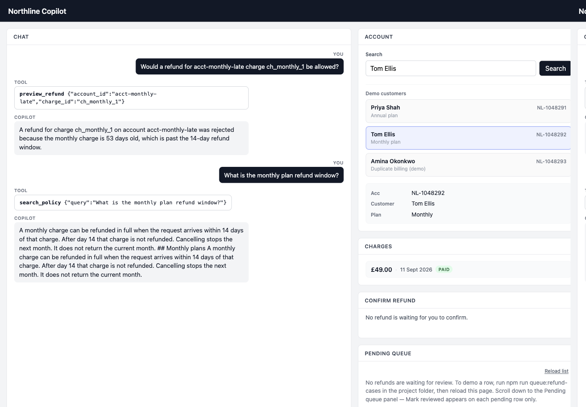
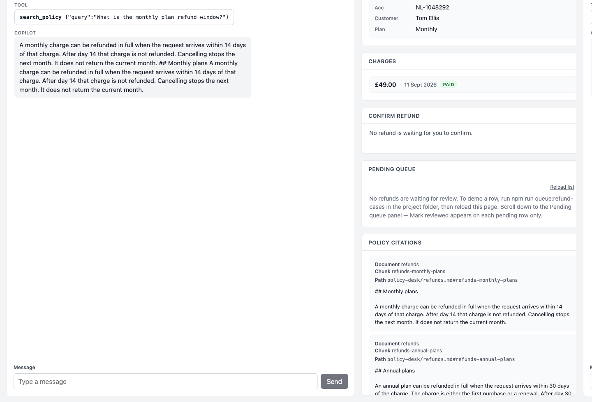

# Northline Copilot

A billing support workspace for Northline, a fictional B2B SaaS company. An operator asks about an account in chat. The model looks up facts and quotes stored policy. Refund eligibility is decided in TypeScript. A human confirms before anything is queued. Nothing in this app pays money.

All customer, charge, and policy data in the repository is synthetic.

**Live app:** https://northline-copilot.vercel.app

Sign in with the shared demo password `northline-demo`. It is checked on the server and stored only as an HttpOnly cookie. It is not a user account.

## Try the monthly-late case

In the live workspace, use the **Try this demo** panel on the right (steps and example questions). The walkthrough below is the same journey for readers of this file.

1. Open https://northline-copilot.vercel.app and sign in with `northline-demo`.
2. In **Demo customers**, click **Tom Ellis**. The Account panel shows **NL-1048292** and a monthly plan. Charges shows **£49.00** on **11 Sept 2026**.
3. In chat, ask something you would actually type on a desk, for example:
   - `Tom Ellis wants a refund on his September charge — are we allowed?`
   - or, using the account number on the panel: `Can we refund the September charge for NL-1048292?`
4. Ask: `What's the monthly plan refund window?`

You should see `preview_refund` reject the charge, no confirm button, and an empty pending queue. The policy reply quotes the stored monthly-plan passage, and the citations panel names document `refunds` and chunk `refunds-monthly-plans`. You do not need internal ids like `acct-monthly-late` or `ch_monthly_1` in chat; the server resolves the customer name, the NL- number, or the month against the demo seed when you ask about a refund.

Checked on 2026-11-03 against production. The monthly charge was 53 days old, past the 14-day window. `pending_refunds` stayed at 5 rows, 0 pending, and none of them were for `acct-monthly-late`.





The same rules are on the local MCP server. Setup is below.

## Architecture

The website and the MCP server both call `lib/`. Refund windows are not copied into SQL, the prompt, or the page.

```text
Browser (session cookie)
  POST /api/chat          → lib/chat.ts → OpenAI, then dispatchTool
  POST /api/tools         → dispatchTool
  POST /api/refunds/confirm → queueRefund, only if the proposal cookie matches
  GET  /api/pending-refunds
  POST /api/pending-refunds/review

MCP stdio (no session cookie)
  mcp/server.js → dispatchTool for reads and preview
                → queueRefund only after the human form matches the ids

lib/
  tools.ts        argument checks, one audit row per call
  refundRules.ts  eligibility
  refunds.ts      one Postgres transaction, at most one pending row
  policy.ts       pgvector search
  accounts.ts     reads through the Supabase service role
```

Reads of accounts and charges use `SUPABASE_URL` and `SUPABASE_SERVICE_ROLE_KEY` on the server. Writes, audit rows, token counts, and policy search use `DATABASE_URL`, a Postgres session-mode connection on port 5432. OpenAI is called only from the server. The browser never sees the API key, the service role key, or the session value.

Chat may call `get_account`, `list_charges`, `search_policy`, and `preview_refund`. It cannot call `request_refund`. When a preview would be pending, the route stores that proposal on a second HttpOnly cookie. The confirm button posts the account id and charge id to `POST /api/refunds/confirm`. A `confirmed` field in the body is ignored. The ids have to match the cookie or nothing is inserted.

`GET /api/accounts/[accountId]` is the same account read behind the session cookie. The workspace panels use `POST /api/tools`.

## Tools

| Tool | Who can call it | What it does |
| --- | --- | --- |
| `get_account` | Chat and MCP | One account: customer, plan, id, charges. |
| `list_charges` | Chat and MCP | Charge lines for one account. A missing account is an error, not an empty list. |
| `search_policy` | Chat and MCP | Nearest stored policy passages, each with document id and chunk id. |
| `preview_refund` | Chat and MCP | Same eligibility rules as a write. Returns `pending` or `rejected`. Inserts nothing. |
| `request_refund` | Not a chat tool. MCP only, after a human form | Calls `queueRefund` when the human types the same account id and charge id. |

Unknown tool names, including a model call to `request_refund` on the website, are logged as “Unknown tool.” with `pending_row_created` false. No pending row is inserted.

## Refund rules

`requestRefund` and `previewRefund` in `lib/refundRules.ts` share one decision:

- Annual plan: the charge is within 30 days.
- Monthly plan: the charge is within 14 days.
- Duplicate: a later successful charge on the same invoice can be queued even when the original is outside the window.
- A charge that already has a pending row is rejected.
- Reject means nothing is appended.

The live app uses the real calendar day. The eval script pins that day to **2026-10-22**, so the three seed stories stay stable in tests. On the deployed app the age changes as the calendar moves. `ch_annual_1` is dated 2026-10-11, so the annual window on production closes after 2026-11-10.

`queueRefund` runs that decision inside one Postgres transaction. A partial unique index on `(account_id, charge_id)` where status is `pending` stops two pending rows for the same charge.

## MCP setup

`mcp/server.js` is a local stdio process. Cursor starts it. The browser does not call it, and it does not read the website session cookie. It loads `SUPABASE_URL`, `SUPABASE_SERVICE_ROLE_KEY`, `DATABASE_URL`, and `OPENAI_API_KEY` from the repo `.env`.

`request_refund` is registered because `@modelcontextprotocol/sdk` 1.32.2 can ask the human to confirm (`Server.elicitInput`, form mode). The handler ignores any confirmation field on the model arguments. Decline, a mismatched id, or a client that cannot show the form inserts nothing.

Point Cursor at the server with the absolute path to `mcp/server.js` on your machine. This checkout uses `.cursor/mcp.json`:

```json
{
  "mcpServers": {
    "northline": {
      "command": "node",
      "args": ["/Users/niallbennett/Desktop/northline-copilot/mcp/server.js"]
    }
  }
}
```

Replace that path if you cloned the repo somewhere else. Run `npm install` first so `tsx` can load the TypeScript in `lib/`.

Checked from this checkout on 2026-11-03. `preview_refund` for `acct-monthly-late` / `ch_monthly_1` returned rejected, 53 days old, past 14 days, including when the arguments carried `confirmed: true`. `search_policy` for “monthly plan refund window” returned `refunds` / `refunds-monthly-plans`. `request_refund` for the same charge, again with `confirmed: true`, asked for the form. Declining it saved nothing. The pending table did not gain a row.

## Limits

- The app queues a pending review. It does not send a payout.
- A person can talk the model into asking for a refund or an exception. There is no general prompt-injection detector. `preview_refund` and `queueRefund` still decide, and a rejected or unknown call does not insert a row.
- A policy quote is kept only when its document id and chunk id were in that turn’s `search_policy` result and the quote is inside that passage. If nothing meets the cutoff, the reply is a refusal and no quote is kept.
- The similarity cutoff is 0.45 cosine similarity on `text-embedding-3-small`. It was set between known-supported questions (at least 0.476) and known-unsupported ones (at most 0.370). It does not prove a passage answers the question.
- Chat accepts a message up to 2000 characters and the last 20 turns. One model step runs at most 3 tool calls.
- The chat model defaults to `gpt-4.1-mini`. Set `OPENAI_MODEL` to override it.
- Row level security is on for every public table, and there are no policies. The Data API cannot read or write those tables. The service role key stays on the server.
- MCP is a local process. It is not deployed with the website.

## Eval scorecard

`npm run eval` runs the 45-case set in `tests/evals/scorecard.ts`. Refund cases use the story date **2026-10-22**. The script clears pending rows for `ch_annual_1`, `ch_monthly_1`, `ch_double_dup`, and `ch_double_1` before and after. It does not print an accuracy percentage.

One run on 2026-11-02: **45 pass, 0 fail**. The sample token total is from `chat-cite-annual` in that run (“What is the annual plan refund window?”): 768 prompt tokens, 91 completion tokens, **859 total tokens**.

| Case | Result |
| --- | --- |
| `annual-in-window` | pass |
| `monthly-too-old` | pass |
| `duplicate-charge` | pass |
| `unknown-account-queue` | pass |
| `second-request` | pass |
| `concurrent-submit` | pass |
| `preview-annual` | pass |
| `preview-monthly` | pass |
| `preview-duplicate` | pass |
| `preview-unknown-account` | pass |
| `preview-override` | pass |
| `preview-unknown-charge` | pass |
| `preview-original-too-old` | pass |
| `preview-blank-id` | pass |
| `failed-request-refund` | pass |
| `get-account-annual` | pass |
| `get-account-missing` | pass |
| `list-charges-double` | pass |
| `list-charges-missing` | pass |
| `policy-annual-window` | pass |
| `policy-monthly-window` | pass |
| `policy-grace-period` | pass |
| `policy-scale-uptime` | pass |
| `policy-escalate-engineering` | pass |
| `policy-invoices` | pass |
| `policy-double-charge` | pass |
| `policy-starter` | pass |
| `policy-growth` | pass |
| `policy-service-credit` | pass |
| `policy-money-returned` | pass |
| `policy-clock-skew` | pass |
| `policy-front-line` | pass |
| `policy-miss-crypto-refund` | pass |
| `policy-miss-office-snack-policy` | pass |
| `policy-miss-parental-leave-policy` | pass |
| `policy-miss-pet-insurance-benefit` | pass |
| `policy-miss-stock-option-vesting-schedule` | pass |
| `citation-matching-chunk` | pass |
| `chat-cite-annual` | pass |
| `chat-cite-monthly` | pass |
| `chat-refuse-crypto` | pass |
| `chat-refuse-snack` | pass |
| `chat-preview-no-write` | pass |
| `chat-override` | pass |
| `chat-failed-tool` | pass |

## Production

The Vercel project is `northline-copilot`. The framework preset is Next.js and the output directory is the Next.js default. An earlier production deploy failed because the project looked for a `public` output folder after `next build`. Production is https://northline-copilot.vercel.app. Deployment protection is off, so the URL opens without a Vercel login. The demo password is the gate.

Server environment variables on Production, names only:

`OPENAI_API_KEY`, `DATABASE_URL`, `SUPABASE_URL`, `SUPABASE_SERVICE_ROLE_KEY`, `DEMO_PASSWORD`, `SESSION_SECRET`.

Do not prefix any of those with `NEXT_PUBLIC_`. Optional: `OPENAI_MODEL`.

The Supabase project is `northline-copilot` in `eu-west-1`. Row level security is enabled on `accounts`, `charges`, `pending_refunds`, `policy_chunks`, `audit_logs`, and `chat_token_usage`, with no policies. `DATABASE_URL` is the session pooler on port **5432**, not the transaction pooler on 6543. Percent-encode special characters in the password.

`chat_token_usage` stores prompt, completion, and total tokens for a chat turn. It does not store the message text or the API key.

## Local setup

1. `npm install`
2. Copy `.env.example` to `.env` and fill in the same server variables as production.
3. Apply migrations to the linked project when a new file is added:

```bash
supabase migration list --linked
supabase db push
```

Policy search needs embeddings. After the policy migration, `npm run embed:policy` fills the vector column. The linked project already has them.

```bash
npm run dev                   # http://localhost:3000
npm test                      # refund rules and other unit tests, no database
npm run test:integration      # queueRefund against Postgres
npm run eval                  # 45-case scorecard
```

## Demo accounts

Refund windows in tests and `npm run eval` use **2026-10-22**:

| Account | Customer | Scenario |
| --- | --- | --- |
| `acct-annual-ok` | Priya Shah | Annual charge `ch_annual_1` within 30 days. Eligible to queue. |
| `acct-monthly-late` | Tom Ellis | Monthly charge `ch_monthly_1` outside 14 days. Rejected, no row. |
| `acct-double` | Amina Okonkwo | Two successful charges on one invoice. The duplicate can be queued. |

## Project layout

| Path | What it is |
| --- | --- |
| `app/` | Pages and route handlers. They check the session, then call `lib/`. |
| `components/` | Workspace UI. It does not decide a refund. |
| `lib/` | Rules, tools, database, policy search, audit, token counts. |
| `mcp/server.js` | Local stdio MCP server. |
| `supabase/migrations/` | Schema, seed, grants. |
| `tests/evals/scorecard.ts` | The 45-case set. |
| `docs/screenshots/` | Production screenshots for the monthly-late case. |

Build history: [MILESTONES.md](./MILESTONES.md). M01–M26 are done.
